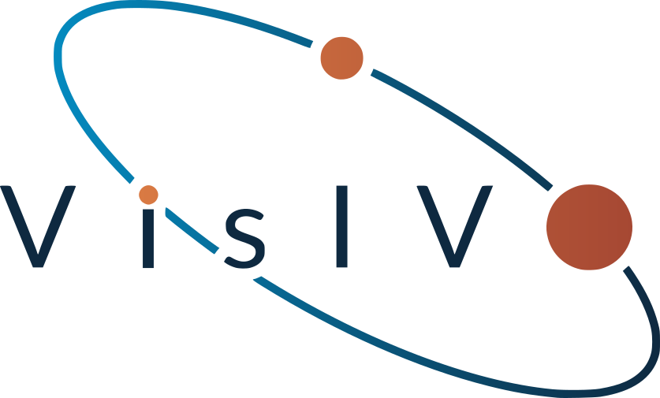

<div align="center">

<picture>
  <source media="(prefers-color-scheme: dark)" srcset="docs/_static/visivo_logo_white.svg">
  
</picture>

# VisIVO Visual Analytics

**Interactive analysis of astronomical data cubes, images and catalogues —
on your desktop, with the heavy computation wherever the data lives.**

[**Documentation**](https://visivo.readthedocs.io/) ·
[User guide](https://visivo.readthedocs.io/en/latest/user-guide/getting-started.html) ·
[Backend API](https://visivo.readthedocs.io/en/latest/backend-api.html) ·
[Building from source](BUILDING.md)

</div>

---

VisIVO Visual Analytics is a desktop application for exploring FITS spectral
cubes, 2-D maps and 3-D catalogues. It pairs a native Qt/VTK client with a
Python compute service, so the same interface works whether your data sits on
the laptop in front of you or on an HPC cluster on another continent — the
client renders, the service computes next to the data, and only the result
travels.

It is developed at **INAF** and is part of the wider VisIVO family, alongside
the [VisIVO Server](https://visivo.readthedocs.io/en/latest/server/visivo_server.html)
command-line toolkit, with which it shares data formats.

## What it does

**Spectral cubes** — slice navigation, cutting plane, probe spectra, isosurface
and GPU volume rendering (composite, MIP, MinIP), camera ROI, animation export.

**Maps and products** — moment maps of orders 0–10 with channel ranges and RMS
masking; line-width (FWHM) and equivalent-width maps; polynomial or median
baseline subtraction; spectral stacking across cubes; position–velocity
diagrams; MAD-based noise estimation.

**Regions and measurement** — box, circle, polygon and annulus statistics; a
geodesic 3-D "kinematic lasso" for selecting coherent structures in a cube;
region import/export in CRTF and ds9 formats.

**Polarimetry** — Stokes Q/U/V companions, polarised intensity and angle, and
rotation-measure synthesis over the frequency axis.

**Images and surveys** — WCS-aware multi-layer 2-D images, all-sky HiPS,
3-D catalogue scatter, VLKB archive cutouts with compact-source and filament
overlays, SED fitting, and SAMP messaging with TOPCAT and Aladin.

**Scientific Copilot** — ask questions in natural language; every number is
produced by a real backend tool rather than generated text, with provenance and
a reproducibility script. Works with a hosted model or one you run yourself.

The [user guide](https://visivo.readthedocs.io/en/latest/) documents each of
these, including the scientific interpretation of the products, not only the
buttons that make them.

## Getting it

### Packaged builds

[`.github/workflows/release.yml`](.github/workflows/release.yml) builds
ready-to-run packages for all four targets and attaches them to the GitHub
release for any version tag (`1.0`, `v1.0.0`, …):

| Platform | Package |
|---|---|
| macOS (Apple Silicon / Intel) | `VisIVOVisualAnalytics-macos-{arm64,x86_64}.dmg` |
| Linux x86-64 | `VisIVOVisualAnalytics-linux-x86_64.tar.gz` (AppImage) |
| Windows x86-64 | `VisIVOVisualAnalytics-windows-x86_64.zip` |

Each package ships its **own Python runtime with the backend's dependencies
already installed**, so a release runs on a machine that has no Python at all.
These builds are unsigned and intended for internal testers: on macOS, open
them the first time with right-click → Open.

### From source

Get the source with
`git clone https://github.com/VisIVOLab/VisIVOVisualAnalytics.git`, then see
[BUILDING.md](BUILDING.md), which has step-by-step recipes for macOS, Linux
and Windows (MSVC 2022). In short, you need Qt 6.10+, VTK 9.5+ built with Qt
support, cfitsio, a C++17 compiler, and Python 3.11+ for the backend.

```bash
cmake -S . -B build -DCMAKE_BUILD_TYPE=Release \
      -DCMAKE_PREFIX_PATH="/path/to/Qt;/path/to/VTK"
cmake --build build --parallel
```

## Running it

Start the application. On first launch it finds or creates a Python
environment, starts the backend itself, and walks you through the token step
before the main window opens — there is nothing to configure for local use.

To run the backend yourself instead:

```bash
cd backend
python3 -m venv .venv && source .venv/bin/activate
pip install -r requirements.txt
uvicorn app.main:app --host 127.0.0.1 --port 8000
```

then start the client with `--no-backend-autostart`.

### Against a remote backend

Run the service on the machine that holds the data, then point the client at it
in **Settings ▸ Backend**: the server URL and the access token the backend
printed at startup. The client never needs the files themselves.

For clusters, the repository ships an Apptainer definition and a SLURM
launcher that allocates a node, starts the service, waits for it to answer, and
prints the SSH tunnel command:

```bash
apptainer build visivo-backend.sif apptainer/backend.def
bash scripts/launch_backend_slurm.sh --sif visivo-backend.sif \
     --bind /data --partition gpu --time 04:00:00
```

The [multi-user backend guide](https://visivo.readthedocs.io/en/latest/multi-user-backend.html)
describes what a shared backend does and does not isolate — read it before
exposing one to colleagues.

## How it fits together

```
┌──────────────────────────┐        HTTP + WebSocket/WebRTC
│  Desktop client (C++)    │  ◄──────────────────────────────►
│  Qt 6 · VTK 9            │        token + session headers
│  interaction, rendering  │
└──────────────────────────┘
                                   ┌───────────────────────────┐
                                   │  Compute service (Python) │
                                   │  FastAPI · astropy · numpy│
                                   │  next to the data         │
                                   └───────────────────────────┘
```

The client owns interaction and rendering. The service owns the data: it
memory-maps FITS so only the requested pixels are read, and runs CPU-bound work
in a process pool so the event loop stays responsive. Cubes too large to ship
are rendered server-side and streamed as video.

Every request carries a **token** and a **session id**: sessions keep each
client's datasets, tasks and results separate, and expire when idle.

The [architecture note](https://visivo.readthedocs.io/en/latest/architecture-note.html)
is the long version.

## Development

```bash
# C++ tests — no VTK or Qt Widgets needed
cmake -S tests -B build-tests && cmake --build build-tests
./build-tests/VisIVOTests

# Backend tests — synthetic FITS fixtures, no real data
cd backend && pip install -r requirements-dev.txt && pytest -q
```

Documentation sources live in [`docs/`](docs/) and are mirrored to
[`VisIVOLab/VisIVO-doc`](https://github.com/VisIVOLab/VisIVO-doc), the repository
Read the Docs builds <https://visivo.readthedocs.io> from; see
[`.github/workflows/sync-docs.yml`](.github/workflows/sync-docs.yml) (or
`scripts/sync-docs.sh` for a manual sync).

Release notes and the development history are in [CHANGELOG.md](CHANGELOG.md).

## Citing

If VisIVO Visual Analytics contributes to work you publish, please cite the
software and this repository. A paper describing the architecture and the
kinematic-lasso selection method is in preparation; this section will carry the
reference once it is available.

## Licence

Apache License 2.0 — see [LICENSE](LICENSE).

Developed at the Istituto Nazionale di Astrofisica (INAF).
